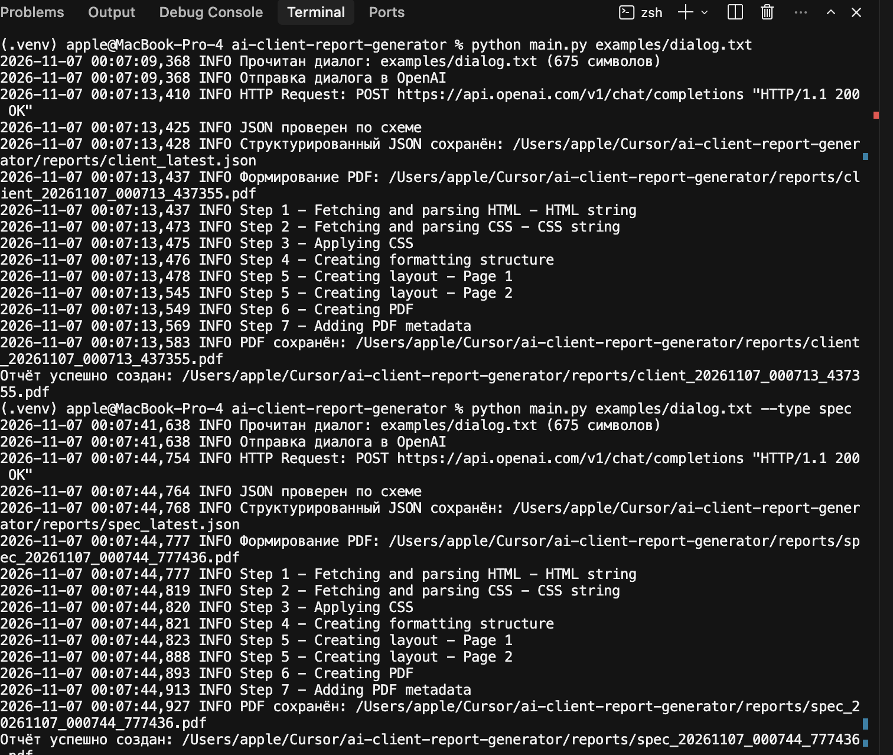
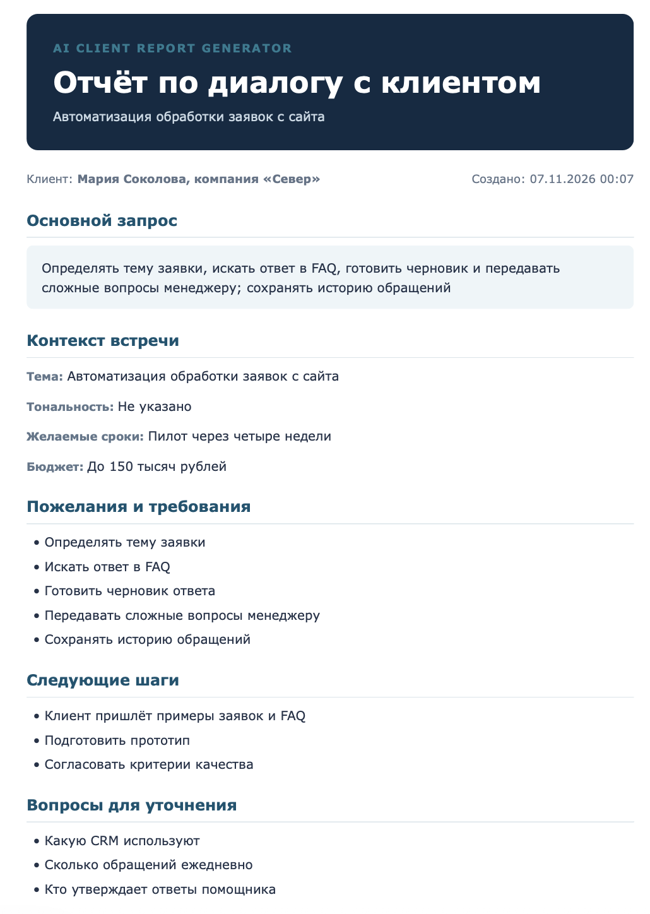
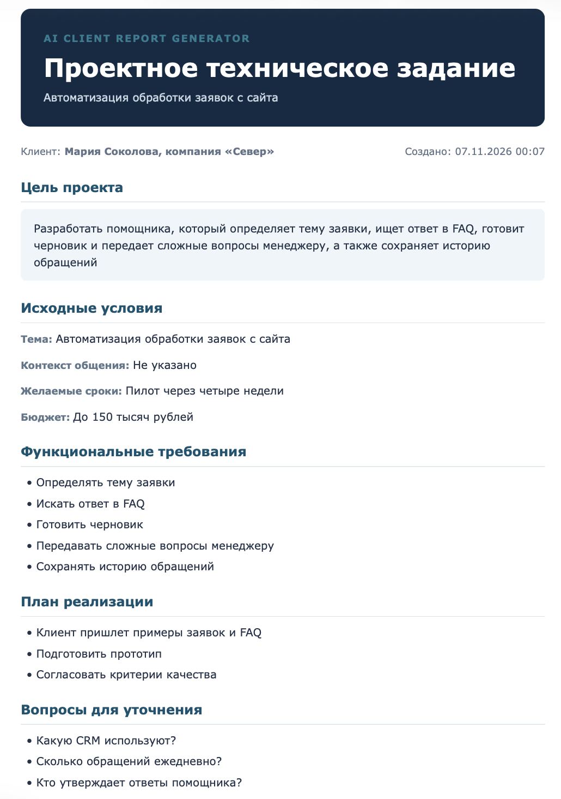

# AI Client Report Generator

Учебный проект VPf10 «Кейс 2: AI-автоматизация». Программа читает текст клиентского диалога, получает из него структурированный JSON, подставляет данные в HTML-шаблон и сохраняет PDF-отчёт.

Проект рассчитан на учебную демонстрацию цепочки «диалог → JSON → PDF». Перед использованием отчёта факты нужно проверить вручную: модель не должна дополнять диалог, но ответ ИИ всё равно требует человеческой проверки.

## Возможности

- Два типа документа из одного диалога: `client` — отчёт о встрече, `spec` — проектное техническое задание.
- Разбор диалога через OpenAI API со строгой JSON-схемой и проверка ответа моделью Pydantic.
- Поля отчёта: клиент, тема, основной запрос, тональность, сроки, бюджет, требования, следующие шаги и открытые вопросы.
- Общий HTML-шаблон Jinja2: заголовки разделов меняются в зависимости от типа отчёта.
- Экранирование HTML, журнал этапов в `logs/app.log` и обработка ошибок чтения, пустого диалога и пустого ответа модели.
- Режим `--demo`: PDF собирается из готового `examples/demo_report.json` без запроса к API. Это заранее подготовленные учебные данные, а не результат работы ИИ.

## Используемые технологии

- Python 3.11
- OpenAI API, модель по умолчанию `gpt-4.1-mini`
- Pydantic 2 — схема отчёта и проверка JSON
- python-dotenv — чтение `.env`
- Jinja2 — HTML-шаблон
- WeasyPrint — HTML в PDF
- pytest — автоматические проверки без вызова API

На этой машине WeasyPrint проверен на macOS Apple Silicon: после указания библиотек Homebrew импорт проходит, оба PDF собираются.

## Архитектура

`main.py` принимает путь к диалогу, тип отчёта и флаг `--demo`. В обычном режиме текст уходит в `utils/ai_processor.py`: пустой диалог отклоняется, при отсутствии ключа программа сообщает, что нужен `OPENAI_API_KEY` или `--demo`. Ответ API проверяется схемой `ClientReport`. В режиме `--demo` схема читается из `examples/demo_report.json`, запрос к OpenAI не выполняется.

Проверенные данные сохраняются в `reports/client_latest.json` или `reports/spec_latest.json`. Затем `utils/pdf_generator.py` заполняет `templates/report_template.html` и записывает PDF в `reports/`. Имя файла содержит тип и время: `client_ГГГГММДД_ЧЧММСС_микросекунды.pdf` или `spec_...pdf`.

Один шаблон обслуживает оба документа. Для `client` разделы называются «Основной запрос», «Контекст встречи», «Пожелания и требования» и «Следующие шаги». Для `spec` те же поля показываются как «Цель проекта», «Исходные условия», «Функциональные требования» и «План реализации».

## Структура каталогов

```text
ai-client-report-generator/
├── main.py                         # аргументы, журнал, выбор режима, запуск PDF
├── requirements.txt
├── .env.example                    # образец переменных без настоящего ключа
├── .gitignore
├── README.md
├── examples/
│   ├── dialog.txt                  # учебный диалог
│   └── demo_report.json            # данные для --demo
├── templates/
│   └── report_template.html
├── utils/
│   ├── __init__.py
│   ├── ai_processor.py             # схема, запрос к OpenAI, проверка JSON
│   └── pdf_generator.py            # Jinja2 и WeasyPrint
├── tests/
│   └── test_project.py
├── screenshots/                    # снимки терминала и двух PDF
├── reports/                        # результаты запуска; в git только .gitkeep
└── logs/                           # создаётся при запуске, в git не входит
```

Каталоги `.venv/`, `__pycache__/`, `.pytest_cache/`, `logs/` и сгенерированные файлы `reports/*.pdf`, `reports/*.json` в репозиторий не входят.

## Установка на macOS

Нужны Python 3.11 или новее и системные библиотеки Pango/Cairo для WeasyPrint. На Apple Silicon их ставит Homebrew:

```bash
brew install pango
python3 -m venv .venv
source .venv/bin/activate
pip install -r requirements.txt
cp .env.example .env
```

Если импорт WeasyPrint не находит библиотеки Homebrew, в том же сеансе терминала укажите путь и проверьте импорт:

```bash
export DYLD_FALLBACK_LIBRARY_PATH="/opt/homebrew/lib:${DYLD_FALLBACK_LIBRARY_PATH:-}"
python -c "from weasyprint import HTML; print('WeasyPrint OK')"
```

Ожидаемый ответ проверки: `WeasyPrint OK`. Переменную окружения нужно задавать заново в каждом новом окне терминала перед генерацией PDF и перед `pytest`.

## Настройка .env

Файл `.env` создаётся локально из образца и не коммитится. В нём две переменные:

```text
OPENAI_API_KEY=your_api_key_here
OPENAI_MODEL=gpt-4.1-mini
```

`OPENAI_API_KEY` — личный ключ OpenAI. В репозиторий кладётся только `.env.example` с текстом-заглушкой `your_api_key_here`. `OPENAI_MODEL` можно оставить `gpt-4.1-mini`: это значение по умолчанию в коде, если переменная не задана.

Режим `--demo` ключ не использует. Для запуска без `--demo` ключ обязателен.

## Запуск двух типов отчётов

Из активированного виртуального окружения, после настройки пути к библиотекам Homebrew, если она нужна:

```bash
python main.py examples/dialog.txt
python main.py examples/dialog.txt --type spec
```

Первая команда строит отчёт о встрече. Вторая — проектное ТЗ по тому же учебному диалогу `examples/dialog.txt`. Диалог описывает вымышленный запрос компании «Север» на автоматизацию заявок с сайта; это пример для занятия, а не карточка реального клиента.

Успешный прогон на этой машине сохранил:

- `reports/client_20261107_000713_437355.pdf` и `reports/client_latest.json`
- `reports/spec_20261107_000744_777436.pdf` и `reports/spec_latest.json`

Оба запроса к `https://api.openai.com/v1/chat/completions` завершились ответом HTTP 200. Эти PDF и JSON остаются на локальной машине: каталог результатов исключён из git, потому что в рабочей папке могут оказаться данные настоящего заказчика.

Повторный запуск создаёт новый PDF с новым временем в имени и перезаписывает соответствующий `*_latest.json`.

## Демонстрационный режим

```bash
python main.py --demo
python main.py --demo --type spec
```

Команды читают `examples/demo_report.json`, проверяют его схемой и сразу собирают PDF. OpenAI не вызывается. В журнале есть строка о том, что использованы данные примера. Демонстрационный JSON отличается от ответа модели по учебному диалогу: в примере клиент указан как «Мария Соколова, ООО „Север“», а в ответе ИИ по `examples/dialog.txt` — «Мария Соколова, компания „Север“».

Локальные файлы `reports/client_DEMO.pdf`, `reports/spec_DEMO.pdf` и `reports/client_DEMO.json` тоже не коммитятся.

## Тестирование

Тесты не обращаются к сети и не читают `.env`. Они проверяют учебную схему, сборку обоих PDF во временный каталог, отказ на пустом диалоге, неизвестный тип отчёта и неполный JSON.

Последний локальный запуск в каталоге проекта:

```text
python -m pytest -q
......
6 passed in 1.01s
```

Шесть проверок соответствуют `tests/test_project.py`: схема примера, PDF типа `client`, PDF типа `spec`, пустой диалог, неизвестный тип и неполная схема. Для сборки PDF в тесте также нужен рабочий WeasyPrint, включая `DYLD_FALLBACK_LIBRARY_PATH`, если без него импорт библиотеки не проходит.

## Примеры готовых PDF

Готовые файлы появляются в `reports/` и в репозиторий не входят. По содержанию это два документа на одном наборе полей.

Отчёт о встрече (`--type client`, значение по умолчанию) содержит основной запрос, контекст встречи, пожелания, следующие шаги и вопросы для уточнения. Проектное ТЗ (`--type spec`) показывает те же данные как цель проекта, исходные условия, функциональные требования и план реализации.

Снимки последнего успешного прогона с OpenAI лежат в `screenshots/` и описаны ниже. Имена локальных PDF этого прогона: `reports/client_20261107_000713_437355.pdf` и `reports/spec_20261107_000744_777436.pdf`.

## Демонстрация работы

Снимки сделаны после реального запуска без `--demo`. В терминале виден путь локального проекта; ключ API на снимках не показан.

Запуск обоих отчётов и ответы API:



Отчёт по диалогу с клиентом:



Проектное техническое задание:



## Что не публиковать

- `.env` и любые настоящие ключи API.
- `logs/`, потому что журнал содержит локальные пути.
- PDF и JSON из `reports/`: учебные файлы этого прогона обезличены до вымышленного примера, но в той же папке позже может появиться диалог реального клиента.
- Каталог `.venv/` и кэш Python.

Перед отправкой в git имеет смысл выполнить `git status` и убедиться, что `.env`, `.venv/`, `logs/` и файлы `reports/*.pdf` / `reports/*.json` не попали в индекс.
